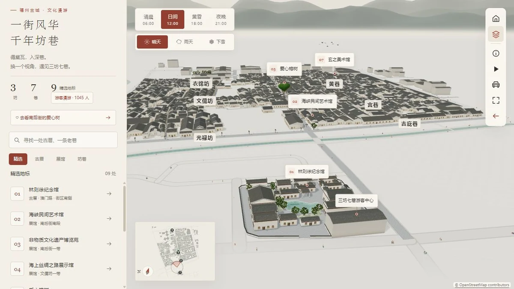
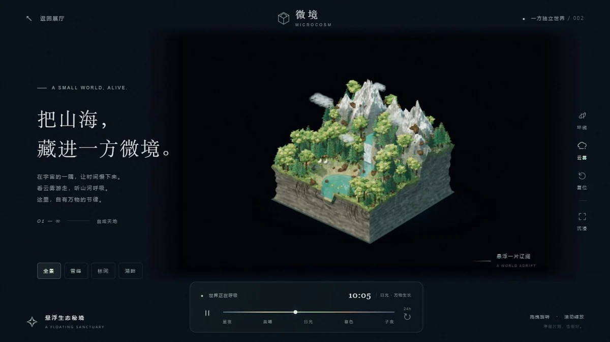
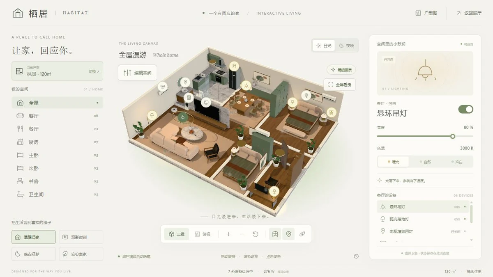
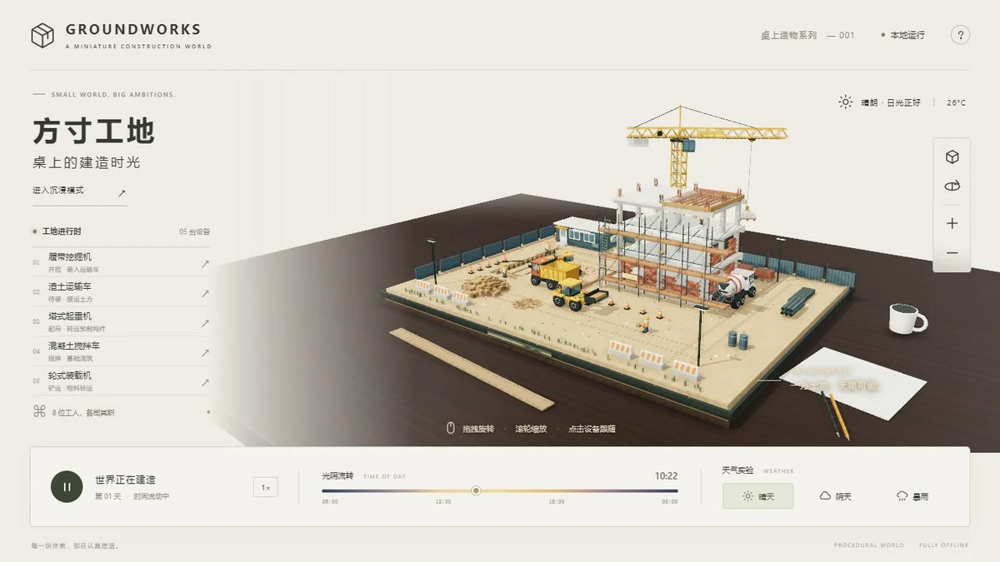
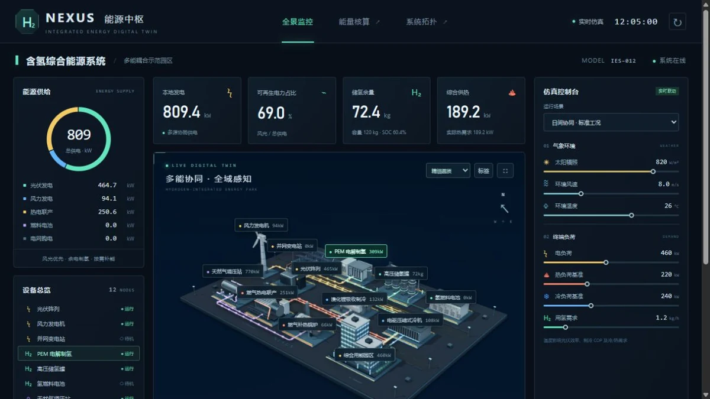
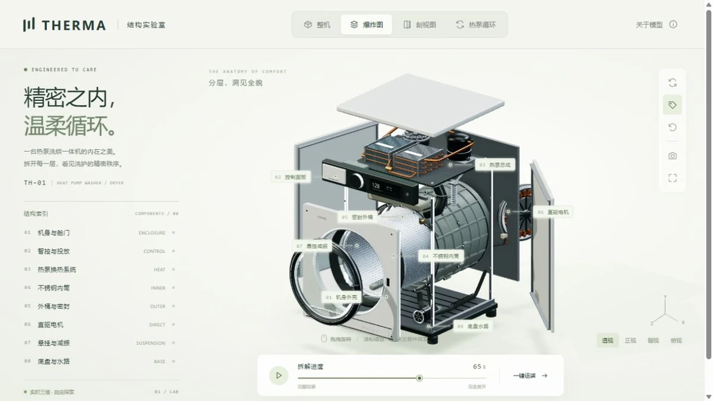
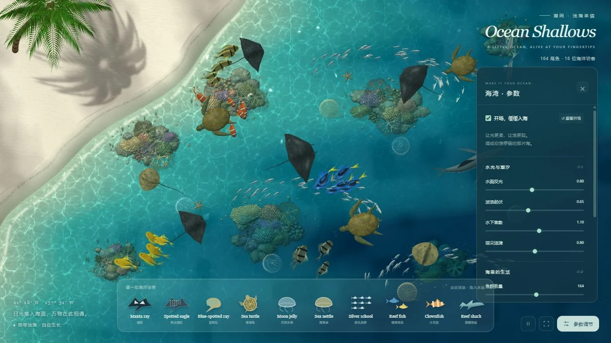
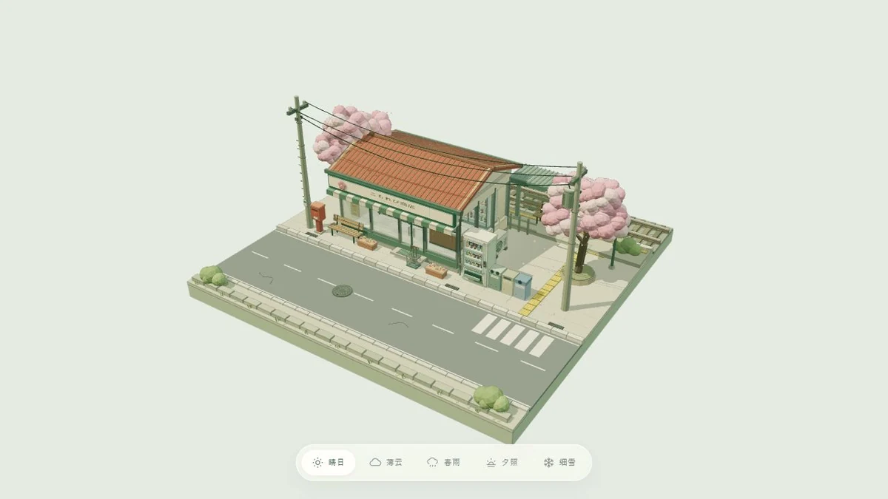
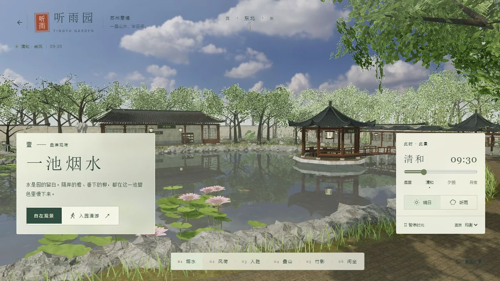

# ai demo 作品集

Vibe Pages 收录了 10 件可在浏览器里操作的三维作品。首页可以按分类筛选，也可以用空格组合多个搜索词。点击卡片会在新页签打开作品，原页保留搜索和筛选结果。[打开作品集](https://qqasd6688.github.io/demo/)

## 作品索引

点击截图可查看原图，点击「README」可阅读操作说明，点击「在线」可直接体验作品。

| 截图 | 名称 | 简介 | 文档 | 预览 |
| --- | --- | --- | --- | --- |
| [](./pages/sanfang-qixiang/assets/cover.webp) | 三坊七巷 | 沿五站路线游览福州古街，也可以操控汉服人物步行、跑动，去纪念馆看荷塘锦鲤。 | [README](./pages/sanfang-qixiang/readme.md) | [在线](https://qqasd6688.github.io/demo/sanfang-qixiang/) |
| [](./pages/microcosm/assets/cover.webp) | 微境 MICROCOSM | 在悬浮生态岛上切换雪峰、林间和湖畔镜头，观察四分钟的昼夜循环。 | [README](./pages/microcosm/readme.md) | [在线](https://qqasd6688.github.io/demo/microcosm/) |
| [](./pages/habitat/assets/cover.webp) | 栖居 HABITAT | 在三套户型中布置家具、替换材质和调节家电，按户型保存设计。 | [README](./pages/habitat/readme.md) | [在线](https://qqasd6688.github.io/demo/habitat/) |
| [](./pages/groundworks/assets/cover.webp) | 方寸工地 | 跟随五台施工机械，调节作业速度，对比晴天与暴雨中的吊运。 | [README](./pages/groundworks/readme.md) | [在线](https://qqasd6688.github.io/demo/groundworks/) |
| [](./pages/hydrogen-nexus/assets/cover.webp) | 氢能中枢 NEXUS | 改变气象和负荷，追踪园区五类能流，在账本中核对供需与储氢变化。 | [README](./pages/hydrogen-nexus/readme.md) | [在线](https://qqasd6688.github.io/demo/hydrogen-nexus/) |
| [](./pages/therma/assets/cover.webp) | THERMA 结构实验室 | 拆解热泵洗烘一体机，单独观察部件、追踪循环并导出 PNG。 | [README](./pages/therma/readme.md) | [在线](https://qqasd6688.github.io/demo/therma/) |
| [](./pages/tidal-bay/assets/cover.webp) | 潮间海湾 | 向浅海添加鱼群、鳐鱼或水母，点出涟漪，调节浪幅和水下光斑。 | [README](./pages/tidal-bay/readme.md) | [在线](https://qqasd6688.github.io/demo/tidal-bay/) |
| [](./pages/sakura-station/assets/cover.webp) | 樱日小站 | 环绕日式站台与便利店，近看货架商品，在五种天气间切换。 | [README](./pages/sakura-station/readme.md) | [在线](https://qqasd6688.github.io/demo/sakura-station/) |
| [](./pages/suzhou-garden/assets/cover.webp) | 听雨园 | 通过游园图前往六处景点，切换第一人称过桥穿廊，开启环境音听雨。 | [README](./pages/suzhou-garden/readme.md) | [在线](https://qqasd6688.github.io/demo/suzhou-garden/) |
| [](./pages/interactive-gallery/assets/cover.webp) | 数字展厅 | 观看星空、地球与六个空白展位的光影，宽屏可拖拽环绕。 | [README](./pages/interactive-gallery/readme.md) | [在线](https://qqasd6688.github.io/demo/interactive-gallery/) |

## 本地运行

仓库声明 Node.js ≥ 22.12.0，包管理器为 pnpm 12.14.0，开发服务使用 Vite 8.3.5。在仓库根目录执行以下命令。

```powershell
pnpm install --frozen-lockfile
pnpm dev
```

打开 [本地作品集](http://localhost:5170/)。单个作品使用目录名作为地址，例如 [本地三坊七巷](http://localhost:5170/sanfang-qixiang/)。Vite 从 `pages/` 读取作品，从 `site/` 读取首页和首页资源，支持 CSS 热替换和脚本更新。默认绑定 `127.0.0.1`，端口占用时可运行 `pnpm dev --port 5174`。

| 根目录命令 | 用途 |
| --- | --- |
| `pnpm test` | 运行公共检查、首页测试和已有的作品专属测试。 |
| `pnpm build` | 校验作品目录名和 HTML 入口，重新生成静态发布目录 `dist/`。 |
| `pnpm preview` | 先执行构建，再在 [本地发布预览](http://127.0.0.1:4173/) 提供生成的文件。修改源码后需重新构建才能看到变化。 |

## 单独运行一个作品

完整复制任一 `pages/<slug>/` 到新位置，可以改名。进入复制后的目录，用静态服务器提供文件，例如安装了 Python 的环境可以运行以下命令，再打开 [独立作品](http://127.0.0.1:8000/)。

```powershell
python -m http.server 8000 --bind 127.0.0.1
```

作品的脚本、样式、模型、贴图和第三方模块都随目录提供。九件作品使用本地 Three.js 0.185.0。潮间海湾直接使用 WebGL 2，还需要模块 Worker 和 OffscreenCanvas。请用支持 WebGL 2 的浏览器通过 HTTP 或 HTTPS 访问。

栖居会保存户型、家具和设备状态，潮间海湾会保存海湾参数，樱日小站将天气写入当前 URL。方寸工地的静态版本在 HTTPS 或本机回环地址下显示“离线就绪”后，可从同一地址断网重载。其他作品要在断网时打开，可以保留完整目录并运行本地静态服务器。

## 维护作品和首页

- `pages/<slug>/` 保存作品入口 `index.html`、使用说明 `readme.md` 和资源 `assets/`。新建作品可从 [基础 HTML 模板](./templates/basic/index.html) 和它的 `assets/` 起步。模板另有旧的 `page.json`，复制时只取入口与资源，再补上作品说明和真实运行截图。
- `site/index.html` 保存首页卡片和数量。新增、删除或改名时，同步标题、可见简介、链接、截图、分类、搜索词、总数及无障碍说明，并更新上面的作品索引。搜索和分类交互由 `site/assets/main.js` 提供。禁用 JavaScript 后仍可通过静态卡片进入全部作品。
- 首页和作品 README 引用同一张作品内封面，当前均为 `assets/cover.webp`。作品运行资源使用相对路径，以支持 GitHub Pages 的 `/demo/` 子路径和改名后的独立目录。
- 公共检查位于 `scripts/`，首页测试位于 `site/tests/`。有专属用例的作品可在自身目录运行 `node --test tests/*.test.mjs`。根目录的 `node --test scripts/standalone-pages.test.mjs` 会把各作品复制到临时目录并改名，静态检查 README、封面、模块、模型和预缓存引用。实际浏览验收使用上面的静态服务器。
- `output/imagegen/` 保存三坊七巷人物的生成提示词、参考图及四视图压缩包。网页实际加载的是作品内的汉服人物 GLB。完整目录、封面和验收约定见 [AGENTS.md](./AGENTS.md)。

## 发布到 GitHub Pages

在仓库的 **Settings → Pages → Build and deployment** 中选择 **GitHub Actions**。推送到 `main` 或在 Actions 中手动运行工作流后，CI 安装锁定依赖、运行测试、构建并上传 `dist/`。部署任务仅在 `main` 上执行。[部署工作流](./.github/workflows/pages.yml)

构建将首页复制为 `dist/index.html`，首页资源放入 `dist/_site/`，每个作品发布到 `dist/<slug>/`，并在发布根目录生成 `.nojekyll`。作品 README 和素材署名随作品发布。作品根下的 `tests/`、`scripts/`，以及作品内的隐藏项、`node_modules`、`page.json` 均被排除。构建只接收普通资源，遇到作品内的符号链接会报错。[构建脚本](./scripts/build.mjs)
