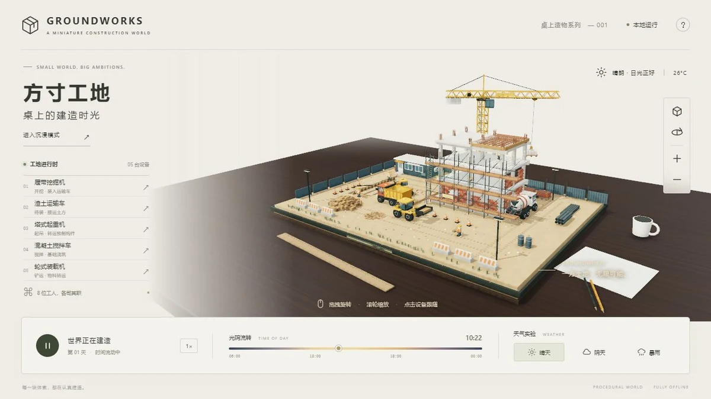

# 方寸工地

## 简介

深色实木工作桌上的微缩建筑工地。以第三人称观察机械协作、工人作业、昼夜更替和晴雨变化，支持自由环绕、设备跟随与沉浸观察。

## 封面



## 功能点

- 挖掘机、运输车、塔吊、搅拌车、装载机及八位工人的循环协作。
- 晴天、阴天、暴雨三种天气。常速下一昼夜约四分钟，暴雨时塔吊停机避风，地面机械减速。
- 点击机械或设备清单跟随观察，支持旋转、缩放、复位和自动环绕。
- 暂停 / 继续施工与沉浸模式；暂停后仍可调整观察视角。
- 静态 HTTP / HTTPS 部署后支持页面范围内的 Service Worker 离线缓存。

## 技术栈

- 原生 HTML、CSS、JavaScript ES Modules；无框架、无后端。
- 本地 Three.js 0.185.0（WebGL 2）、OrbitControls、程序化几何与 Canvas 纹理。
- 自定义环境遮蔽、HDR 渲染目标、环境反射及浏览器 Cache API。

## 独立运行

完整复制本作品目录，保留所有子目录。在副本中运行以下命令即可单独预览。

```powershell
python -m http.server 8000 --bind 127.0.0.1
```

用支持 WebGL 2 的浏览器打开 <http://127.0.0.1:8000/>。目录可以改名，也可整体部署到静态站点的子路径。

## 操作说明

在合集仓库根目录运行 `pnpm dev`，打开 <http://localhost:5170/groundworks/>。

| 操作 | 效果 |
| --- | --- |
| 拖拽 / 单指拖拽 | 旋转观察 |
| 滚轮 / 双指缩放 | 调整观察距离 |
| 点击机械或点选清单中的设备 | 跟随设备作业。再次点选清单中的同一设备，或按 R 返回全景 |
| 倍速按钮 / 时间滑块 | 在 1×、2×、4× 间循环，或直接移到想看的时刻 |
| 空格 / 暂停按钮 | 暂停或继续施工 |
| R / F / Esc | 复位视角 / 切换沉浸 / 退出沉浸或关闭指南 |

## 资源目录

| 路径 | 用途 |
| --- | --- |
| index.html / readme.md | 作品入口 / 当前使用说明 |
| assets/cover.webp | 真实页面截图，首页与本 README 共用 |
| sw.js | 本作品范围的静态离线缓存 |
| assets/main.js、style.css | 页面交互、控制台、快捷键和响应式样式 |
| assets/world.js、model-detail.js | 场景、机械模型、施工循环、天气和相机 |
| assets/finish.js | 程序材质、环境反射及后处理 |
| assets/icon.svg | 页面图标 |
| assets/vendor/three/ | 本地渲染库及完整附加依赖、MIT 许可 |

## 素材与许可

- [Three.js MIT 许可证](./assets/vendor/three/LICENSE)。核心和所需附加模块随作品保存。
- 机械、建筑、桌面、纹理和标识由代码生成，不需要下载外部模型、照片或 HDR。

## 数据与限制

建筑主体已预先搭好，设备和工人的作业循环用于观察。刷新会重新开始施工。

要体验断网重载，可用 `pnpm preview` 或上述静态服务器打开作品。通过 HTTPS 或本机回环地址首次加载，等页首显示“离线就绪”，再断网重载同一地址。缓存按部署路径隔离，清除站点数据后需要重新加载。`pnpm dev` 的热更新模式跳过 Service Worker 注册。维护离线资源时，同步更新 `sw.js` 的 `FILES` 和版本。
