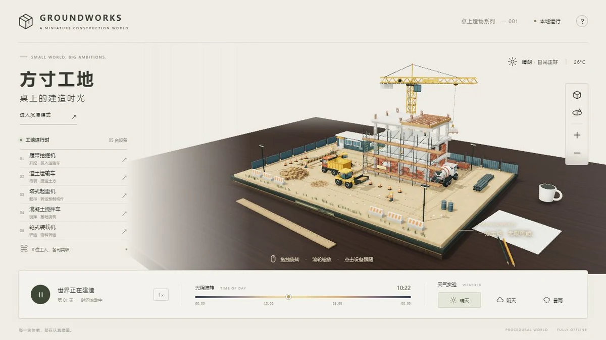

# 方寸工地

## 简介

深色实木工作桌上的微缩建筑工地。以第三人称观察机械协作、工人作业、昼夜更替和晴雨变化，支持自由环绕、设备跟随与沉浸观察。

## 封面



## 功能点

- 挖掘机、运输车、塔吊、搅拌车、装载机及八位工人的循环协作。
- 晴天、阴天、暴雨与完整昼夜变化，支持调节时间和模拟速度。
- 点击机械或设备清单跟随观察，支持旋转、缩放、复位和自动环绕。
- 暂停 / 继续施工与沉浸模式；暂停后仍可调整观察视角。
- 静态 HTTP / HTTPS 部署后支持页面范围内的 Service Worker 离线缓存。

## 技术栈

- 原生 HTML、CSS、JavaScript ES Modules；无框架、无后端。
- 本地 Three.js 0.185.0（WebGL 2）、OrbitControls、程序化几何与 Canvas 纹理。
- 自定义环境遮蔽、HDR 渲染目标、环境反射及浏览器 Cache API。

## 独立运行

完整复制本作品目录，在复制后的目录中打开终端，运行：

```powershell
python -m http.server 8000 --bind 127.0.0.1
```

访问 <http://127.0.0.1:8000/>。也可交给其他静态 HTTP / HTTPS 服务托管；无需安装本仓库的 pnpm 依赖、执行构建或启动后端。运行文件都在当前目录，目录可以改名，支持部署在站点子路径。

页面使用 ES 模块和本地资源加载，请通过 HTTP / HTTPS 访问，不直接双击 HTML。使用支持 WebGL 2 的现代浏览器。

## 操作说明

| 操作 | 效果 |
| --- | --- |
| 拖拽 / 单指拖拽 | 旋转观察 |
| 滚轮 / 双指缩放 | 调整观察距离 |
| 点击机械或设备清单 | 进入设备跟随；复位按钮返回全景 |
| 空格 / 暂停按钮 | 暂停或继续施工 |
| R / F / Esc | 复位视角 / 切换沉浸 / 退出沉浸或关闭指南 |

## 资源目录

| 路径 | 用途 |
| --- | --- |
| index.html / readme.md | 作品入口 / 当前使用说明 |
| assets/cover.webp | 真实页面截图，首页与本 README 共用 |
| sw.js | 本作品范围的静态离线缓存 |
| assets/main.js、style.css | 页面交互、控制台、快捷键和响应式样式 |
| assets/world.js、model-detail.js | 场景、机械模型、施工循环、天气和相机 |
| assets/finish.js | 程序材质、环境反射及后处理 |
| assets/icon.svg | 页面图标 |
| assets/vendor/three/ | 本地渲染库及完整附加依赖、MIT 许可 |

## 素材与许可

- [Three.js MIT 许可证](./assets/vendor/three/LICENSE)。核心和所需附加模块随作品保存。
- 机械、建筑、桌面、纹理和标识由代码生成，不需要下载外部模型、照片或 HDR。

## 数据与限制

施工是循环作业演示，建筑主体预先生成，并非逐砖建造或具有工程精度的施工模拟。状态不作长期保存。没有互联网时，本地静态服务器仍可运行。首次完整加载并显示“离线就绪”后，浏览器缓存还可供同一来源和路径离线重载；缓存可能被浏览器回收，不能替代原始文件。Service Worker 需 HTTPS 或 localhost / 127.0.0.1，缓存按部署路径隔离。修改运行文件时更新 sw.js 的 FILES 和缓存版本。

## 在合集仓库中开发

在仓库根目录运行 `pnpm dev`，访问 <http://localhost:5170/groundworks/>；发布前运行 `pnpm build`。这些是合集维护命令，独立运行本作品不需要仓库根目录、其他作品或首页资源。封面、标题、简介发生变化时，手动同步合集入口 `site/index.html`。
