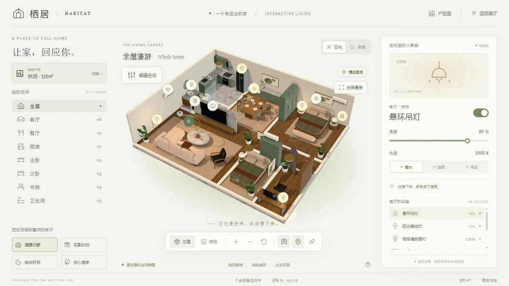

# 栖居 HABITAT

## 简介

可以布置家具、替换材质并控制灯光家电的三维住宅。切换三套概念户型，自由观察空间，并让家具布局与设备状态在浏览器中分别保存。

## 封面



## 功能点

- 三套住宅分别为 85 ㎡「晨光」、120 ㎡「林间」和 220 ㎡「云邸」，各有房间导航、家电清单和二维户型图。
- 逐个调节灯光、空调、电视或窗帘，也可用「温暖归家」「观影时刻」「晚安好梦」「安心离家」一次切换多台设备。
- 移动、旋转家具，替换预设材质；提供精确输入、吸附和撤销 / 重做。
- 三维与俯视切换、自动隐藏遮挡墙体、设备标记、全屏看房和手机控制抽屉。
- 按户型分别保存设备及家具编辑状态，支持恢复默认布局。

## 技术栈

- 原生 HTML、CSS、JavaScript ES Modules；无框架、无后端。
- 本地 Three.js 0.185.0（WebGL 2）、OrbitControls、GLTFLoader、HDRLoader。
- 本地 PBR 贴图、glTF 家具、HDR 环境、GTAO / 辉光后处理及 SVG 户型图。
- localStorage 保存户型选择、设备状态和家具编辑结果。

## 独立运行

完整复制本作品目录，保留所有子目录。在副本中运行以下命令即可单独预览。

```powershell
python -m http.server 8000 --bind 127.0.0.1
```

用支持 WebGL 2 的浏览器打开 <http://127.0.0.1:8000/>。目录可以改名，也可整体部署到静态站点的子路径。

## 操作说明

在合集仓库根目录运行 `pnpm dev`，打开 <http://localhost:5170/habitat/>。

| 操作 | 效果 |
| --- | --- |
| 左键 / 单指拖动；滚轮 / 双指捏合 | 旋转、缩放；右键 / 双指拖动平移 |
| 点击房间、设备或设备标记 | 聚焦房间或打开独立控制面板 |
| 编辑空间 | 拖动家具，使用圆环或输入框旋转、调整位置与材质 |
| 编辑时让画布获得焦点，使用方向键或 Q / E | 每次移动 10 cm 或旋转 15°。按住 Shift 可微调至 1 cm 或 1° |
| Ctrl+Z / Ctrl+Shift+Z | 撤销 / 重做家具编辑；macOS 使用对应 Command 组合键 |
| 观察时让画布获得焦点，使用方向键、+ / − 或 Home | 旋转、缩放或回到全屋视角 |
| 恢复原样 / 恢复本户型全部家具 | 分别重置选中家具或当前户型的家具，两种操作都可撤销 |

## 资源目录

| 路径 | 用途 |
| --- | --- |
| index.html / readme.md | 作品入口 / 当前使用说明 |
| assets/cover.webp | 真实页面截图，首页与本 README 共用 |
| assets/main.js、style.css、editor.css | 界面、户型选择和手机控制抽屉 |
| assets/layouts.js、state.js、design-state.js | 户型、设备、编辑状态与持久化 |
| assets/editor.js、editor-ui.js、furniture.js | 家具拾取、拖拽、材质替换和编辑界面 |
| assets/world.js、model.js、furnishings.js、rendering.js | 三维建筑、家具装配、相机与后处理 |
| assets/materials/、models/ | PBR / HDR、扶手椅 glTF、二进制和贴图及来源记录 |
| assets/plans/、floorplan.js | 三套二维户型图和绘制逻辑。维护户型数据后可在作品源码目录运行 `node scripts/generate-plans.mjs` 更新 SVG |
| assets/vendor/three/ | 本地渲染库及完整附加依赖、MIT 许可 |

## 素材与许可

- [Three.js MIT 许可证](./assets/vendor/three/LICENSE)。所需核心、加载器和后处理模块均已包含。
- 木作、织物与环境素材来自 Poly Haven，石材来自 ambientCG，素材记录为 CC0；见 [材质来源清单](./assets/materials/attribution.json)。
- 扶手椅 glTF、二进制与贴图均在本目录，见 [模型来源与许可](./assets/models/lounge-chair/attribution.json)。其余建筑和家具由程序生成。

## 数据与限制

户型和设备均为本地概念演示。家具可在户型外轮廓内移动，内墙或其他家具仍可能与它重叠。二维户型图展示预设平面，编辑结果请在三维视图中查看。

设备与家具使用不同的 `habitat-` 存储键。家具拖动结束后保存，当前编辑历史最多保留 50 步。刷新可以恢复已保存的布局，撤销历史只在本次编辑中有效。存储受限时仍可编辑，界面会提示保存状态。
