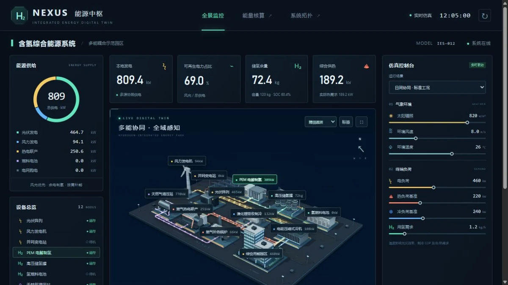

# 氢能中枢 NEXUS

## 简介

三维综合能源园区与浏览器内实时仿真，展示电、热、冷、氢和天然气之间的转换、储存、输送和需求平衡。可从全景进入设备特写，调节气象与负荷，查看能量核算。

## 封面



## 功能点

- 12 类能源设备的独立工业模型、实时标签、设备参数及近距离观察。
- 五类带方向的能流管线，可按能源种类筛选。
- 独立调节辐照度、风速、环境温度、电 / 热 / 冷负荷和用氢需求。
- 四种预设工况涵盖日间协同、绿电富余、晚间保供和高温高负荷。储氢状态、功率趋势和供能缺口随参数更新。
- 能量守恒账本、系统拓扑说明、仿真暂停 / 继续及参数重置。
- 精细 / 流畅画质、透视 / 俯视、自动环绕、标签显隐和全屏展示。

## 技术栈

- 原生 HTML、CSS、JavaScript ES Modules；无框架、无后端。
- 本地 Three.js 0.185.0（WebGL 2）、OrbitControls、SSAO 与 HDR 辉光。
- 工业模型和材质由程序生成，供能调度与储氢积分使用原生 JavaScript。SVG 趋势图绘制最近 60 个模拟分钟的风光发电、总用电与购电功率。

## 独立运行

完整复制本作品目录，保留所有子目录。在副本中运行以下命令即可单独预览。

```powershell
python -m http.server 8000 --bind 127.0.0.1
```

用支持 WebGL 2 的浏览器打开 <http://127.0.0.1:8000/>。目录可以改名，也可整体部署到静态站点的子路径。

## 操作说明

在合集仓库根目录运行 `pnpm dev`，打开 <http://localhost:5170/hydrogen-nexus/>。

| 操作 | 效果 |
| --- | --- |
| 拖动 / 滚轮 / 双指手势 | 环绕、缩放和观察场站 |
| 点击设备、标签或设备清单 | 查看参数；设备特写靠近当前选中设备 |
| 工况选择与参数滑块 | 切换预设或进入自定义仿真 |
| 能流图例 | 筛选电、热、冷、氢或天然气管线 |
| 能量核算 / 系统拓扑 | 查看守恒账本与模型假设 |
| 暂停 / 继续 | 暂停或恢复时间推进和趋势采样。页面处于后台时也会暂停推进 |
| 重置仿真 | 恢复日间标准工况、72 kg 初始储氢和起始时刻，重新开始记录趋势 |
| Tab、方向键和 Enter | 用 Tab 定位设备按钮、工况选择框或滑块，按方向键调值，按 Enter 激活按钮 |

## 资源目录

| 路径 | 用途 |
| --- | --- |
| index.html / readme.md | 作品入口 / 当前使用说明 |
| assets/cover.webp | 真实页面截图，首页与本 README 共用 |
| assets/main.js、style.css | 交互界面、图表与控制台 |
| assets/simulation.js | 设备参数、工况、功率调度及氢质量积分 |
| assets/scene.js、industrial-details.js | 园区布局、管线与工业部件 |
| assets/materials.js、rendering.js | 程序材质、SSAO、抗锯齿和辉光 |
| assets/favicon.svg | 页面图标 |
| assets/vendor/three/ | 本地渲染库及完整附加依赖、MIT 许可 |

## 素材与许可

- [Three.js MIT 许可证](./assets/vendor/three/LICENSE)；[本地渲染库说明](./assets/vendor/README.md)。
- 设备几何、标识和材质由程序生成，不依赖外部模型、贴图服务或 CDN。页面里的能源原理参考链接仅供主动阅读，不参与运行。

## 数据与限制

气象、设备效率和容量来自本地仿真假设。运行时每秒推进一个模拟分钟，按产氢与耗氢之差更新储罐。刷新会恢复初始工况。即使浏览器无法创建三维场景，仍可用控制台调参、从设备清单查看参数并打开能量账本。
