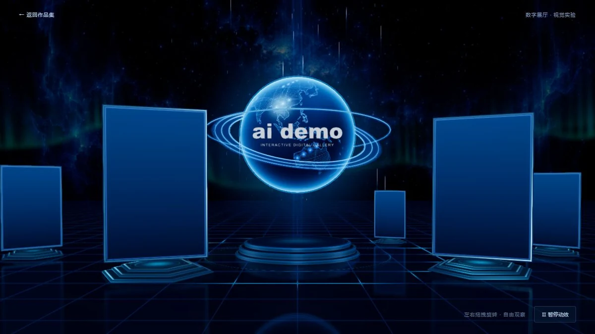

# 数字展厅

## 简介

从原合集入口迁移而来的独立三维视觉实验。星空、发光地球、镜面台座和六个空白展位构成可拖拽环绕的数字展厅；展位不显示作品内容，也不承担其他作品的导航。

## 封面



## 功能点

- 星空、地球点阵轮廓、环形光带、粒子与镜面反射。
- 宽屏下地球与六个展位依次入场，随后展位绕地球运行。
- 左右拖拽调整环绕位置，支持用户主动暂停和继续动效。
- 六张卡片内容为空，没有封面、文字或作品跳转。
- 窄屏显示地球与两列空白展位；WebGL 不可用时保留静态展示。

## 技术栈

- 原生 HTML、CSS、JavaScript ES Modules；无框架、无后端。
- 本地 Three.js 0.185.0（WebGL 2）、Reflector、EffectComposer、辉光及 FXAA。
- 本地星空位图、Natural Earth 陆地轮廓和程序化面板 / 台座。

## 独立运行

完整复制本作品目录，保留所有子目录。在副本中运行以下命令即可单独预览。

```powershell
python -m http.server 8000 --bind 127.0.0.1
```

用支持 WebGL 2 的浏览器打开 <http://127.0.0.1:8000/>。目录可以改名，也可整体部署到静态站点的子路径。

## 操作说明

在合集仓库根目录运行 `pnpm dev`，打开 <http://localhost:5170/interactive-gallery/>。

| 操作 | 效果 |
| --- | --- |
| 在宽度至少 760 px 的展厅左右拖动 | 改变展位的环绕位置，松手后自动环绕继续（已暂停时保持暂停） |
| 在窄屏上浏览 | 地球与两列静态展位直接排布，可用下方按钮控制场景动效 |
| 暂停动效 / 继续动效 | 点击或轻触切换。键盘可用 Tab 选中按钮，再按空格或 Enter 操作 |

## 资源目录

| 路径 | 用途 |
| --- | --- |
| index.html / readme.md | 作品入口 / 当前使用说明 |
| assets/cover.webp | 真实页面截图，首页与本 README 共用 |
| assets/main.js、entrance.css | 启动、拖拽、暂停控件和响应式布局 |
| assets/scene.js、motion.js | 三维场景、镜面、入场及轨道计算 |
| assets/card-content.js | 为空白展位提供透明内容图层 |
| assets/images/starfield.webp | 本地星空背景 |
| assets/images/world-land.json | 本地陆地轮廓快照 |
| assets/vendor/three/ | 本地渲染库及完整附加依赖、MIT 许可 |

## 素材与许可

- [Three.js MIT 许可证](./assets/vendor/three/LICENSE)；[本地依赖说明](./assets/vendor/README.md)。
- Natural Earth 陆地轮廓为本地快照，仅用于装饰地球，素材记录见 [图片来源](./assets/images/README.md)。星空为原展厅生成素材。

## 数据与限制

页面切到后台时暂停场景更新，回到前台后依照动效按钮的状态继续。三维初始化失败时显示静态展厅，并停用动效按钮。重新加载会从初始展示开始。
