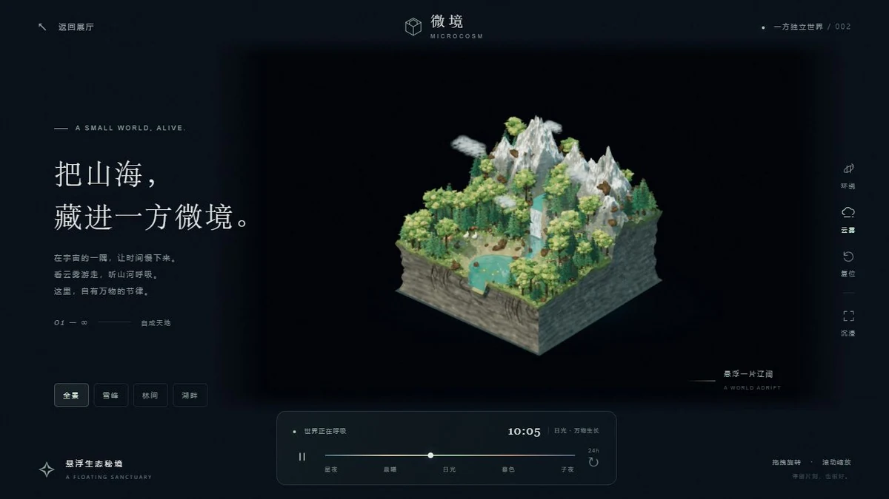

# 微境 MICROCOSM

## 简介

一方可以近看雪峰、森林和湖泊的悬浮生态岛。围绕微缩山海旋转观察，切换全景与局部镜头，看昼夜、云雾和自然细节缓慢变化。

## 封面



## 功能点

- 积雪岩脊、针叶林、菌菇、倒木、树根、睡莲与微型动物。
- 全景、雪峰、林间和湖畔四个观察预设，自由旋转、缩放与复位。
- 四分钟昼夜循环、时间滑块及星夜 / 晨曦 / 日光 / 暮色预设。
- 暂停时间、切换云雾、自动环绕与纯观景模式。
- 本地 PBR 贴图、水面倒影、环境遮蔽、MSAA 与 FXAA 抗锯齿。

## 技术栈

- 原生 HTML、CSS、JavaScript ES Modules；无框架、无后端。
- 本地 Three.js 0.185.0（WebGL 2）、OrbitControls、程序地形和植被几何。
- 本地 Poly Haven PBR 贴图、自定义环境遮蔽和水面倒影。

## 独立运行

完整复制本作品目录，在复制后的目录中打开终端，运行：

```powershell
python -m http.server 8000 --bind 127.0.0.1
```

访问 <http://127.0.0.1:8000/>。也可交给其他静态 HTTP / HTTPS 服务托管；无需安装本仓库的 pnpm 依赖、执行构建或启动后端。运行文件都在当前目录，目录可以改名，支持部署在站点子路径。

页面使用 ES 模块和本地资源加载，请通过 HTTP / HTTPS 访问，不直接双击 HTML。使用支持 WebGL 2 的现代浏览器。

## 操作说明

| 操作 | 效果 |
| --- | --- |
| 拖动 / 滚轮 / 双指缩放 | 旋转并调整观察距离 |
| 全景 / 雪峰 / 林间 / 湖畔 | 切换观察位置 |
| 时间滑块与昼夜预设 | 调整岛屿的日光与夜色 |
| 暂停时间 / 云雾 / 环绕 | 控制时间、氛围和相机 |
| 方向键 / Home | 旋转观察 / 恢复默认视角 |

## 资源目录

| 路径 | 用途 |
| --- | --- |
| index.html / readme.md | 作品入口 / 当前使用说明 |
| assets/cover.webp | 真实页面截图，首页与本 README 共用 |
| assets/main.js、style.css | 页面控制、时间状态与响应式界面 |
| assets/world.js、landscape.js、forest.js、understory.js | 地形、植被、林下生态和镜头 |
| assets/materials.js、textures/ | 本地岩石 / 树皮贴图及加载逻辑 |
| assets/occlusion.js | 环境遮蔽与抗锯齿处理 |
| assets/favicon.svg | 页面图标 |
| assets/vendor/three/ | 本地渲染库及完整附加依赖、MIT 许可 |

## 素材与许可

- [Three.js MIT 许可证](./assets/vendor/three/LICENSE)。
- 岩石、树皮的 Diffuse / Normal / ARM 贴图来自 Poly Haven，按 CC0 保存；详见 [材质来源说明](./assets/textures/README.md)。
- 地形、树木、生态细节、云雾和标识由程序生成，不需要运行时下载模型。

## 数据与限制

场景是程序化微缩生态演示，没有真实地理数据或生态仿真服务。当前版本没有玻璃外壳。时间和镜头等状态只保留在当前会话，刷新恢复默认。材质、相机和后处理耗时随设备而异，没有离线浏览器缓存保证。

## 在合集仓库中开发

在仓库根目录运行 `pnpm dev`，访问 <http://localhost:5170/microcosm/>；发布前运行 `pnpm build`。这些是合集维护命令，独立运行本作品不需要仓库根目录、其他作品或首页资源。封面、标题、简介发生变化时，手动同步合集入口 `site/index.html`。
