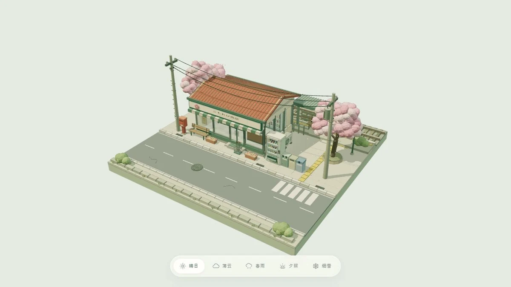

# 樱日小站

## 简介

樱花、乡村站台、街角便利店组成的日式微缩景观。以低多边形几何和柔和色块呈现春日小世界，可自由旋转、平移、缩放并切换五种天气。

## 封面



## 功能点

- 16×16 底座上的便利店、街道、铁路、站台及两侧樱花树。
- 店内货架、冰柜、收银台、十二种商品及透明玻璃饮料贩卖机。
- 雨伞、分类垃圾桶、长椅、路灯、站钟、电线杆及相连电线等独立道具。
- 晴日、薄云、春雨、夕照和细雪，天气过渡包含光照、背景和粒子变化。
- 连续缩放、无限制环绕旋转、平移与手机双指手势。
- 可选 toon 色阶风格，支持通过 URL 设置天气与风格。

## 技术栈

- 原生 HTML、CSS、JavaScript ES Modules；无框架、无后端。
- 本地 Three.js 0.185.0（WebGL 2）、自定义 DioramaControls。
- 程序化几何、CanvasTexture 内容贴图、共享材质和静态阴影缓存。

## 独立运行

完整复制本作品目录，在复制后的目录中打开终端，运行：

```powershell
python -m http.server 8000 --bind 127.0.0.1
```

访问 <http://127.0.0.1:8000/>。也可交给其他静态 HTTP / HTTPS 服务托管；无需安装本仓库的 pnpm 依赖、执行构建或启动后端。运行文件都在当前目录，目录可以改名，支持部署在站点子路径。

页面使用 ES 模块和本地资源加载，请通过 HTTP / HTTPS 访问，不直接双击 HTML。使用支持 WebGL 2 的现代浏览器。本作品没有合集导航依赖。

## 操作说明

| 操作 | 效果 |
| --- | --- |
| 左键 / 单指拖动 | 环绕旋转 |
| 右键、中键、Shift 拖动 / 双指拖动 | 平移 |
| 滚轮 / 双指捏合；+ / − | 连续缩放 |
| 天气按钮 / 数字 1–5 | 晴日、薄云、春雨、夕照、细雪 |
| 方向键 / Home | 平移 / 复位 |

## 资源目录

| 路径 | 用途 |
| --- | --- |
| index.html / readme.md | 作品入口 / 当前使用说明 |
| assets/cover.webp | 真实页面截图，首页与本 README 共用 |
| assets/main.js、style.css | 启动、加载进度、天气栏与布局 |
| assets/core/ | 渲染、几何、植物、交互、内容材质和天气 |
| assets/map/ | 世界和店内的资产装配 |
| assets/models/、models/products/ | 独立建筑、道具、植物和逐件商品模型 |
| assets/favicon.svg | 页面图标 |
| assets/vendor/three/ | 本地渲染库及完整附加依赖、MIT 许可 |

## 素材与许可

- [Three.js MIT 许可证](./assets/vendor/three/LICENSE)。
- 建筑、植物、商品、广告和包装图形由本作品代码生成，无外部模型、HDR、网络字体或 CDN。

## 数据与限制

无人物、动物、车辆驾驶、自动相机环绕或真实便利店业务。默认平涂哑光，?style=toon 启用色阶；?weather=sunny|cloudy|rain|sunset|snow 设置初始天气。切换天气更新当前 URL，不使用 localStorage 保存场景；刷新后依据 URL 参数重新打开。页面没有返回合集控件，独立使用不需要合集导航。

## 在合集仓库中开发

在仓库根目录运行 `pnpm dev`，访问 <http://localhost:5170/sakura-station/>；发布前运行 `pnpm build`。这些是合集维护命令，独立运行本作品不需要仓库根目录、其他作品或首页资源。封面、标题、简介发生变化时，手动同步合集入口 `site/index.html`。
