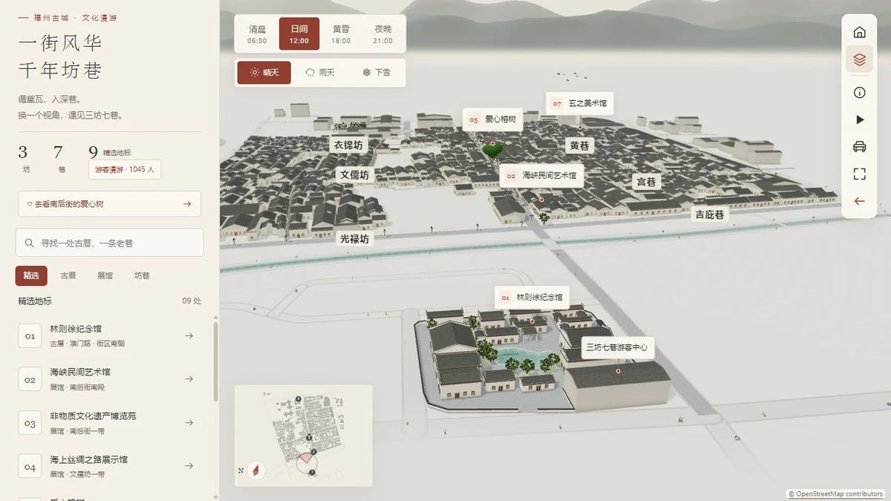

# 三坊七巷

## 简介

以本地地图快照和示意建筑呈现福州三坊七巷文化街区。通过景点导览、街区小地图、四时天气和汉服人物漫游，在古厝与坊巷之间自由观察和漫游。

## 封面



## 功能点

- 本地建筑轮廓、街巷与水系，补充爱心榕树及林则徐纪念馆的示意布局。
- 九处精选地标由南向北编号，另可按坊巷或地址搜索。小地图同步显示主视角方向，指南针可将视角转回朝北。
- 日间、清晨、黄昏、夜晚，以及晴天、雨天、下雪的渐进变化。
- 屋面雨雪遮挡、积水和倒影、渐进积雪、建筑细节、行人与植被。
- 河道采用灰绿水色、浅岸与深槽层次、泥沙斑块和柔和流纹，保留建筑倒影及雨天涟漪。
- 纪念馆池塘采用起伏泥沙池底、深浅藻绿水色与柔和倒影，锦鲤在水下游动，岸边分簇布置荷叶和粉色荷花。
- 使用带骨骼和待机 / 行走 / 跑步动画的 Tripo 汉服女性角色进行第三人称漫游，WASD 步行、Shift 跑动，支持触屏方向按钮、道路碰撞和退出后恢复视角。
- 全景复位、景点标签、全屏浏览、资料来源与地图归属说明。

## 技术栈

- 原生 HTML、JavaScript ES Modules 和静态 CSS；工具类 CSS 已预编译，运行无需 Tailwind 构建。
- 本地 Three.js 0.185.0（WebGL 2）、OrbitControls、程序建筑与天气着色器。
- 本地 JSON 地图数据、Canvas 小地图、地图投影及碰撞处理；无地图 API 运行依赖。

## 独立运行

完整复制本作品目录，保留所有子目录。在副本中运行以下命令即可单独预览。

```powershell
python -m http.server 8000 --bind 127.0.0.1
```

用支持 WebGL 2 的浏览器打开 <http://127.0.0.1:8000/>。目录可以改名，也可整体部署到静态站点的子路径。

## 操作说明

在合集仓库根目录运行 `pnpm dev`，打开 <http://localhost:5170/sanfang-qixiang/>。

| 操作 | 效果 |
| --- | --- |
| 左键拖拽；右键拖动；滚轮 | 旋转；平移；缩放街区 |
| 点击建筑、爱心树、地图标签或小地图上的建筑 | 查看选中地点，保留当前镜头 |
| 搜索后点击列表项，或点击「飞到这里」 | 飞向所选景点。选择坊巷时还会高亮对应街巷 |
| 时段 / 天气按钮 | 改变光照、降雨和积雪 |
| 开始 / 停止导览 | 从林则徐纪念馆沿路北行，经海峡民间艺术馆、非遗博览苑、爱心榕树，到林觉民·冰心故居。走完回到全景，中途停止则保留当前视野 |
| 普通浏览时聚焦画布，使用方向键、+ / −、Home 或 Esc | 平移、缩放、回到全景或打断镜头飞行 |
| 漫游时 W / S、A / D；按住 Shift | 按视角方向移动；跑动（松开 Shift 恢复步行） |
| 人物按钮 / 漫游时拖动 / Esc | 首次载入角色后从澳门桥北侧出发，拖动调整跟随镜头，按 Esc 退出并恢复原视野 |
| 触屏方向按钮、跑动按钮 | 按住方向移动，可同时按住“跑”加速；松手即停 |

## 资源目录

| 路径 | 用途 |
| --- | --- |
| index.html / readme.md | 作品入口 / 当前使用说明 |
| assets/cover.webp | 真实页面截图，首页与本 README 共用 |
| assets/main.js、guide-model.js、icons.js | 页面交互、数据整合和图标 |
| assets/styles/ | 页面布局、导览、天气、小地图与说明面板样式 |
| assets/runtime/ | 建筑、植被、渲染、天气、地图、人物漫游和生命周期 |
| assets/runtime/pond-life.js | 程序池底、荷叶、荷花、锦鲤模型及水下游动路径 |
| assets/models/hanfu-walker.glb、runtime/character.js | 轻量骨骼汉服角色、延迟加载与待机 / 行走 / 跑步动画 |
| scripts/optimize-character.mjs | 使用外部原始模型重新生成轻量角色的离线工具，不随页面发布 |
| assets/data/map-data.json | 可离线读取的地图快照 |
| assets/data/landmarks.js、linzexu-memorial.js | 补充地标和馆区示意布局 |
| assets/data/README.md | 地图来源、数据归属和补建资料许可 |
| assets/vendor/three/ | 本地渲染库及完整附加依赖、MIT 许可 |

## 素材与许可

- [Three.js MIT 许可证](./assets/vendor/three/LICENSE)。
- 地图数据来自 © OpenStreetMap contributors，按 ODbL 1.0 使用；林则徐纪念馆补建示意参考 CC BY-SA 4.0 导览图。详见 [数据与参考资料说明](./assets/data/README.md)。
- 汉服人物由用户提供的 Tripo 导出文件优化而来，仓库只保留轻量版 `assets/models/hanfu-walker.glb`。模型包含 78 根骨骼和 `idle`、`walk`、`run` 动画；人物按约 1.72 米身高落地，动作平滑切换，动画内水平偏移由控制器抵消。素材的再分发许可未随文件提供。
- 页面保留数据归属和原始资料链接；照片只作建模参考，没有作为运行贴图分发。建筑外观、地形、植物、池底、锦鲤、荷花及天气由程序生成。荷塘中的动植物布置为场景示意。

## 数据与限制

这是文化导览的示意模型，不是测绘复原、实时地图或真实路况。建筑高度、内部布局、树形、游客及天气不代表现场状态；人物漫游是本地交互演示。原始地图快照保存在作品内，运行不请求在线地图服务。搜索、相机、天气和人物位置不长期保存。

当前汉服模型约 6.01 MB、152,198 个三角面、98,018 个顶点，内嵌 2048 × 2048 JPEG 贴图；首次点击人物按钮时才加载，加载期间可再次点击取消进入。减面与顶点量化会减少近距离细节；低性能设备仍可能掉帧。页面通过本地 Three.js 原生支持的 `KHR_mesh_quantization` 读取模型，无额外在线解码器。

资源优化工具使用 glTF Transform 4.5.1、meshoptimizer 1.2.0 和 ImageMagick 7，仅重新生成模型时需要。将这些开发工具准备到可解析的 Node.js 环境，并自行提供仓库外的原始模型后，在作品目录运行 `node scripts/optimize-character.mjs "外部原始模型路径.glb"`。工具合并重复顶点，以 0.08 面数比例、0.001 几何误差上限减面，精简重复动画关键帧，量化顶点属性，并以 88 质量重编码 2048 像素贴图；日常浏览、独立托管和 `pnpm build` 均不需要这些工具。
