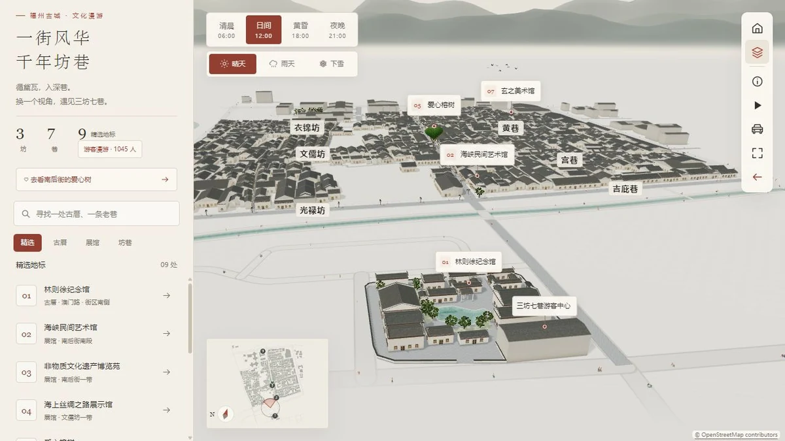

# 三坊七巷

## 简介

以本地地图快照和示意建筑呈现福州三坊七巷文化街区。通过景点导览、街区小地图、四时天气和可驾驶小车，在古厝与坊巷之间自由观察和漫游。

## 封面



## 功能点

- 本地建筑轮廓、街巷与水系，补充爱心榕树及林则徐纪念馆的示意布局。
- 景点搜索、分类、定位、高亮与自动导览；小地图与主场景同步。
- 日间、清晨、黄昏、夜晚，以及晴天、雨天、下雪的渐进变化。
- 屋面雨雪遮挡、积水和倒影、渐进积雪、建筑细节、行人与植被。
- 小车驾驶、鼠标观察与方向控制，支持键盘操作和退出驾驶。
- 全景复位、景点标签、全屏浏览、资料来源与地图归属说明。

## 技术栈

- 原生 HTML、JavaScript ES Modules 和静态 CSS；工具类 CSS 已预编译，运行无需 Tailwind 构建。
- 本地 Three.js 0.185.0（WebGL 2）、OrbitControls、程序建筑与天气着色器。
- 本地 JSON 地图数据、Canvas 小地图、地图投影及碰撞处理；无地图 API 运行依赖。

## 独立运行

完整复制本作品目录，在复制后的目录中打开终端，运行：

```powershell
python -m http.server 8000 --bind 127.0.0.1
```

访问 <http://127.0.0.1:8000/>。也可交给其他静态 HTTP / HTTPS 服务托管；无需安装本仓库的 pnpm 依赖、执行构建或启动后端。运行文件都在当前目录，目录可以改名，支持部署在站点子路径。

页面使用 ES 模块和本地资源加载，请通过 HTTP / HTTPS 访问，不直接双击 HTML。使用支持 WebGL 2 的现代浏览器。

## 操作说明

| 操作 | 效果 |
| --- | --- |
| 左键拖拽；右键拖动；滚轮 | 旋转；平移；缩放街区 |
| 搜索、景点列表、小地图 | 查找或选择景点并定位 |
| 时段 / 天气按钮 | 改变光照、降雨和积雪 |
| 开始导览 / 返回全景 | 进入自动路线 / 恢复总览 |
| 驾驶时 W / S、A / D | 前后行驶、左右平移 |
| 驾驶时鼠标左键 / 退出驾驶控件 | 调整观察方向并带动车头 / 返回普通浏览 |

## 资源目录

| 路径 | 用途 |
| --- | --- |
| index.html / readme.md | 作品入口 / 当前使用说明 |
| assets/cover.webp | 真实页面截图，首页与本 README 共用 |
| assets/main.js、guide-model.js、icons.js | 页面交互、数据整合和图标 |
| assets/styles/ | 页面布局、导览、天气、小地图与说明面板样式 |
| assets/runtime/ | 建筑、植被、渲染、天气、地图、驾驶和生命周期 |
| assets/data/map-data.json | 可离线读取的地图快照 |
| assets/data/landmarks.js、linzexu-memorial.js | 补充地标和馆区示意布局 |
| assets/data/README.md | 地图来源、数据归属和补建资料许可 |
| assets/vendor/three/ | 本地渲染库及完整附加依赖、MIT 许可 |

## 素材与许可

- [Three.js MIT 许可证](./assets/vendor/three/LICENSE)。
- 地图数据来自 © OpenStreetMap contributors，按 ODbL 1.0 使用；林则徐纪念馆补建示意参考 CC BY-SA 4.0 导览图。详见 [数据与参考资料说明](./assets/data/README.md)。
- 页面保留数据归属和原始资料链接；照片只作建模参考，没有作为运行贴图分发。建筑外观、地形、植物及天气由程序生成。

## 数据与限制

这是文化导览的示意模型，不是测绘复原、实时地图或真实路况。建筑高度、内部布局、树形、游客及天气不代表现场状态；驾驶是本地交互演示。原始地图快照保存在作品内，运行不请求在线地图服务。搜索、相机、天气和驾驶状态不长期保存。

## 在合集仓库中开发

在仓库根目录运行 `pnpm dev`，访问 <http://localhost:5170/sanfang-qixiang/>；发布前运行 `pnpm build`。这些是合集维护命令，独立运行本作品不需要仓库根目录、其他作品或首页资源。封面、标题、简介发生变化时，手动同步合集入口 `site/index.html`。
