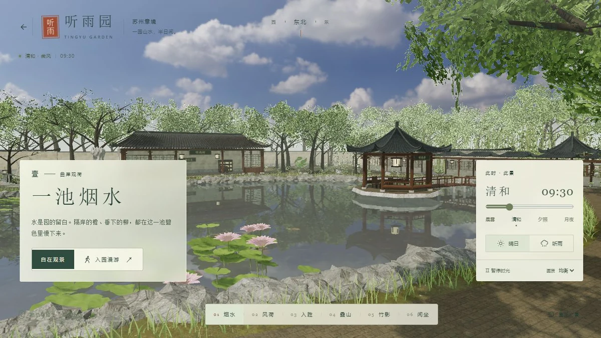

# 听雨园

## 简介

一园山水，半日闲。取意于江南古典园林的原创三维场景，约 140×110 米；可观景、入园行走，穿过月洞与曲桥，观察粉墙黛瓦、叠石、水亭、风荷与游鱼。

## 封面



## 功能点

- 烟水、风荷、入胜、叠山、竹影和闲坐六景，支持游园图定位。
- 自由环绕观景与第一人称步行，包含岸线、桥面和墙体碰撞。
- 晨雾、清和、夕照、月夜与时间滑块，支持晴日、听雨及暂停时光。
- 平面水反射、荷叶、锦鲤、植被风动、夜间灯火和雨景。
- 可主动开启本地环境录音及程序雨声，默认静音。
- 精致、均衡、流畅三档画质，支持沉浸观察及手机触控行走。

## 技术栈

- 原生 HTML、CSS、JavaScript ES Modules；无框架、无后端。
- 本地 Three.js 0.185.0（WebGL 2）、HDRLoader、反射、GTAO 与辉光。
- 本地 PBR / HDR、程序化建筑和植物、碰撞运动、HTMLAudio 与 Web Audio。

## 独立运行

完整复制本作品目录，在复制后的目录中打开终端，运行：

```powershell
python -m http.server 8000 --bind 127.0.0.1
```

访问 <http://127.0.0.1:8000/>。也可交给其他静态 HTTP / HTTPS 服务托管；无需安装本仓库的 pnpm 依赖、执行构建或启动后端。运行文件都在当前目录，目录可以改名，支持部署在站点子路径。

页面使用 ES 模块和本地资源加载，请通过 HTTP / HTTPS 访问，不直接双击 HTML。使用支持 WebGL 2 的现代浏览器。

## 操作说明

| 操作 | 效果 |
| --- | --- |
| 观景模式拖动 / 滚轮 / 右键 | 环顾 / 远近 / 平移 |
| WASD 或方向键；Shift | 入园模式行走；快行 |
| 手机摇杆 / 拖动画面 | 行走 / 转头 |
| 游园图与六景按钮 | 查看位置或前往景点 |
| 环境音 / 时光 / 天气 / 画质 | 主动控制声音、时间和渲染效果 |
| 沉浸按钮 / Esc | 隐藏或恢复界面；释放主动锁定的鼠标 |

## 资源目录

| 路径 | 用途 |
| --- | --- |
| index.html / readme.md | 作品入口 / 当前使用说明 |
| assets/cover.webp | 真实页面截图，首页与本 README 共用 |
| assets/main.js、style.css、navigation.js | 页面、触屏控制、地图与行走 |
| assets/layout.js | 布局、岸线、桥面高度和碰撞 |
| assets/architecture.js、landscape.js、vegetation.js、geometry.js | 园林建筑、叠石、植物及几何工具 |
| assets/world.js、water.js、environment.js、materials.js | 渲染、水体、日夜、天气和材质 |
| assets/textures/ | 本地扫描贴图、HDR 天空和来源清单 |
| assets/audio.js、audio/ | 环境音开关、本地录音和署名 |
| assets/vendor/three/ | 本地渲染库及完整附加依赖、MIT 许可 |

## 素材与许可

- [Three.js MIT 许可证](./assets/vendor/three/LICENSE)。
- 扫描贴图和 HDR 天空来自 Poly Haven，按 CC0 保存；见 [材质来源说明](./assets/textures/README.md)、[贴图清单](./assets/textures/sources.json) 和 [天空清单](./assets/textures/sky-sources.json)。
- 风、晨鸟、虫鸣和水声取自 Tidewater 所附的 Freesound CC0 素材，并非苏州实地采录；见 [录音来源与作者](./assets/audio/CREDITS.md)。雨声由程序生成。

## 数据与限制

原创园林并非现实景点测绘复原。场景采用程序化几何和浏览器实时渲染，没有路径追踪或流体物理求解。声音仅在用户主动开启后播放；画质、时间、视角等不长期保存。离线使用需由本地静态服务继续提供文件，没有 Service Worker 离线重载保证。

## 在合集仓库中开发

在仓库根目录运行 `pnpm dev`，访问 <http://localhost:5170/suzhou-garden/>；发布前运行 `pnpm build`。这些是合集维护命令，独立运行本作品不需要仓库根目录、其他作品或首页资源。封面、标题、简介发生变化时，手动同步合集入口 `site/index.html`。
