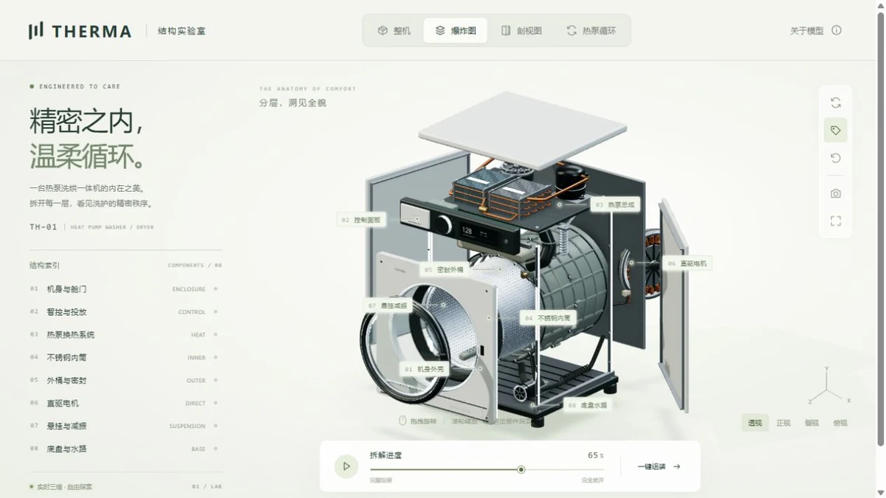

# THERMA 结构实验室

## 简介

可自由拆解和观察热泵洗烘一体机的三维结构实验室。通过整机、爆炸、剖视与热泵循环视图，探索机械层次、空气和冷媒回路的关系。

## 封面



## 功能点

- 整机、爆炸图、剖视图与热泵循环四种视图。
- 八类部件索引、模型拾取、标注、说明与单件观察。
- 拆解滑块、拆解动画、一键组装与独立暂停。
- 空气 / 冷媒流向、循环步骤和动态热泵回路。
- 相机旋转、缩放、透视 / 正视 / 侧视 / 俯视预设和自动旋转。
- 标注开关、沉浸展示，以及生成和下载高清 PNG。

## 技术栈

- 原生 HTML、CSS、JavaScript ES Modules；无框架、无后端。
- 本地 Three.js 0.185.0（WebGL 2）、OrbitControls、程序化机械几何与物理材质。
- GTAO、HDR 渲染目标、MSAA、接触阴影与本地摄影棚环境。

## 独立运行

完整复制本作品目录，在复制后的目录中打开终端，运行：

```powershell
python -m http.server 8000 --bind 127.0.0.1
```

访问 <http://127.0.0.1:8000/>。也可交给其他静态 HTTP / HTTPS 服务托管；无需安装本仓库的 pnpm 依赖、执行构建或启动后端。运行文件都在当前目录，目录可以改名，支持部署在站点子路径。

页面使用 ES 模块和本地资源加载，请通过 HTTP / HTTPS 访问，不直接双击 HTML。使用支持 WebGL 2 的现代浏览器。

## 操作说明

| 操作 | 效果 |
| --- | --- |
| 拖拽 / 滚轮 / 双指缩放 | 旋转和缩放模型 |
| 整机 / 爆炸图 / 剖视图 / 热泵循环 | 切换观察方式 |
| 点击部件、标注或结构索引 | 阅读说明并聚焦部件 |
| 拆解滑块 / 播放 / 一键组装 | 控制拆装进度 |
| 画布获得焦点后 + / − / 0 | 缩放 / 重置相机 |
| 导出图片 / 沉浸 / Esc | 预览并下载 PNG / 切换沉浸 / 退出 |

## 资源目录

| 路径 | 用途 |
| --- | --- |
| index.html / readme.md | 作品入口 / 当前使用说明 |
| assets/cover.webp | 真实页面截图，首页与本 README 共用 |
| assets/main.js、style.css | 模型视图、说明面板和导出界面 |
| assets/model.js、detailing.js | 洗烘机部件、真实孔洞和机械细节 |
| assets/scene.js | 部件交互、视图、拆解与相机 |
| assets/rendering.js、surfaces.js | GTAO、阴影、摄影棚环境和程序表面纹理 |
| assets/favicon.svg | 页面图标 |
| assets/vendor/three/ | 本地渲染库及完整附加依赖、MIT 许可 |

## 素材与许可

- [Three.js MIT 许可证](./assets/vendor/three/LICENSE)；[本地渲染库说明](./assets/vendor/README.md)。
- 模型、金属 / 塑料 / 橡胶表面和摄影棚环境由代码生成，不依赖外部模型、HDR 下载、字体服务或 CDN。页面原理参考链接只在用户主动打开时访问。

## 数据与限制

模型展示典型热泵洗烘结构，是为观察作出的简化，不对应在售机型，也不是维修拆机教程。界面“透视”表示斜向展示预设，底层使用正交相机。图片导出只在浏览器内生成，需用户主动保存；视图和拆解进度不长期保存。

## 在合集仓库中开发

在仓库根目录运行 `pnpm dev`，访问 <http://localhost:5170/therma/>；发布前运行 `pnpm build`。这些是合集维护命令，独立运行本作品不需要仓库根目录、其他作品或首页资源。封面、标题、简介发生变化时，手动同步合集入口 `site/index.html`。
