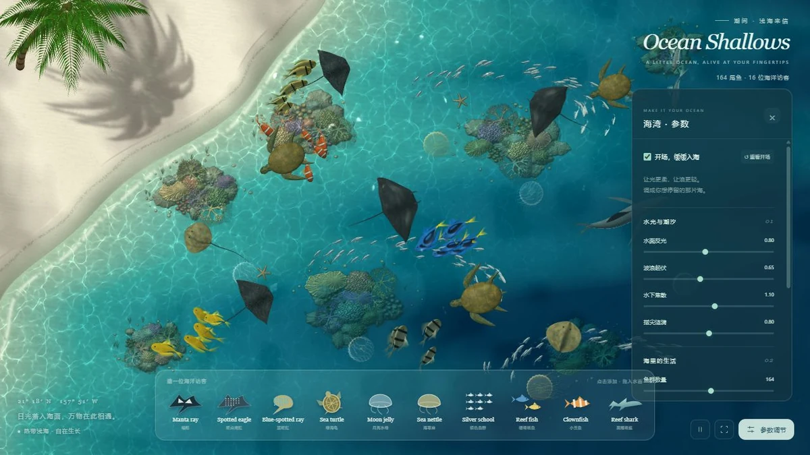

# 潮间海湾

## 简介

一片可添加海洋访客、调节水光与潮汐的热带浅海。透明海水、折射光、珊瑚、鱼群、海龟、鳐鱼与水母构成可交互的俯视海洋世界。

## 封面



## 功能点

- 十种海洋访客卡片，支持点击添加或拖入水面，并点击生物互动。
- 点击水面投下涟漪，键盘也可触发水面互动。
- 调节水面反光、波浪、焦散、涟漪、鱼群数量、珊瑚丰茂与游动节奏。
- 鱼群穿境、海豚跃水和海风事件。
- 缩放近观、缓缓入海的开场、暂停 / 继续和纯观景模式。
- 本地保存参数、恢复初始设置；模块 Worker 烘焙纹理。

## 技术栈

- 原生 HTML、CSS、JavaScript ES Modules；直接使用 WebGL 2 与 GLSL，无 Three.js 或框架。
- 模块 Web Worker、OffscreenCanvas、程序化鱼体和海洋生物网格。
- 本地扫描贴图、海岸 / 珊瑚 / 焦散烘焙、自适应渲染分辨率及 MSAA。
- localStorage 保存海湾参数。

## 独立运行

完整复制本作品目录，在复制后的目录中打开终端，运行：

```powershell
python -m http.server 8000 --bind 127.0.0.1
```

访问 <http://127.0.0.1:8000/>。也可交给其他静态 HTTP / HTTPS 服务托管；无需安装本仓库的 pnpm 依赖、执行构建或启动后端。运行文件都在当前目录，目录可以改名，支持部署在站点子路径。

页面使用 ES 模块和本地资源加载，请通过 HTTP / HTTPS 访问，不直接双击 HTML。使用支持 WebGL 2 的现代浏览器。本作品没有合集导航依赖。

## 操作说明

| 操作 | 效果 |
| --- | --- |
| 点击水面 / Enter | 投下涟漪 |
| 生物卡片点击或拖入海水 | 添加海洋访客 |
| 滚轮、+ / −、0 | 近观缩放 / 恢复全景 |
| 参数面板与事件按钮 | 调节海湾，触发鱼群、海豚或海风 |
| 空格 / 暂停按钮 | 暂停或继续 |
| 纯观景 / Esc | 隐藏或恢复界面、收起面板 |

## 资源目录

| 路径 | 用途 |
| --- | --- |
| index.html / readme.md | 作品入口 / 当前使用说明 |
| assets/cover.webp | 真实页面截图，首页与本 README 共用 |
| assets/main.js、style.css、interface.js、settings.js | WebGL 启动、卡片、参数界面与存储 |
| assets/coast.js、bake-worker.js、reef.js、waves.js | 海岸、珊瑚和折射光场烘焙 |
| assets/geometry.js、skin.js、ecosystem.js | 鱼体、植物与海洋访客网格 |
| assets/shaders.js、marine-shaders.js、marine-materials.js、lighting.js | 水体、鱼皮和海洋生物材质、统一照明 |
| assets/materials.js、materials/ | 五张本地扫描贴图与来源校验记录 |
| assets/simulation.js | 相机、涟漪和渲染分辨率控制 |

## 素材与许可

- 五张扫描贴图来自 Poly Haven 的 Coral Ground 02 与 Coast Sand 01，记录为 Rob Tuytel 的 CC0 作品；见 [素材许可](./assets/materials/LICENSE.md) 与 [来源清单](./assets/materials/sources.json)。
- 生物、珊瑚形态、海岸、粒子、水体和光场逻辑由本作品代码生成；珊瑚扫描用于表面微纹理，不是完整珊瑚模型。

## 数据与限制

需要支持 WebGL 2、模块 Worker 和 OffscreenCanvas 的现代浏览器。首次启动需本地烘焙场景纹理，初始化耗时依设备而异。相机是俯视缩放，不支持任意空间旋转；生物路径与水光为视觉模拟，不是完整避碰或流体计算。设置键为 tidal-bay:ecosystem:v3，只保存在当前站点来源；清除站点存储或恢复初始会重置参数。页面没有合集导航依赖，没有 Service Worker 离线重载保证。

## 在合集仓库中开发

在仓库根目录运行 `pnpm dev`，访问 <http://localhost:5170/tidal-bay/>；发布前运行 `pnpm build`。这些是合集维护命令，独立运行本作品不需要仓库根目录、其他作品或首页资源。封面、标题、简介发生变化时，手动同步合集入口 `site/index.html`。
